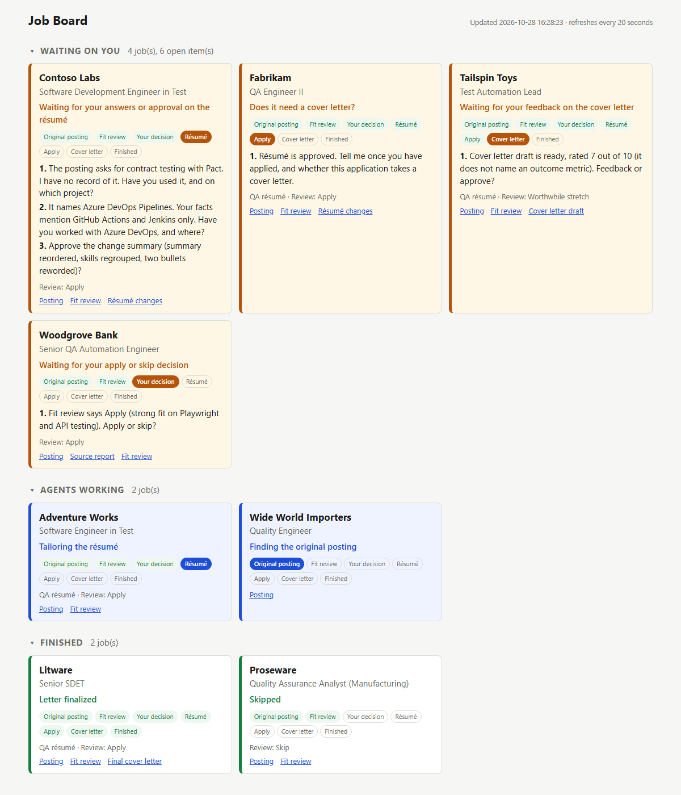
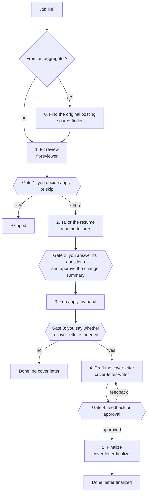
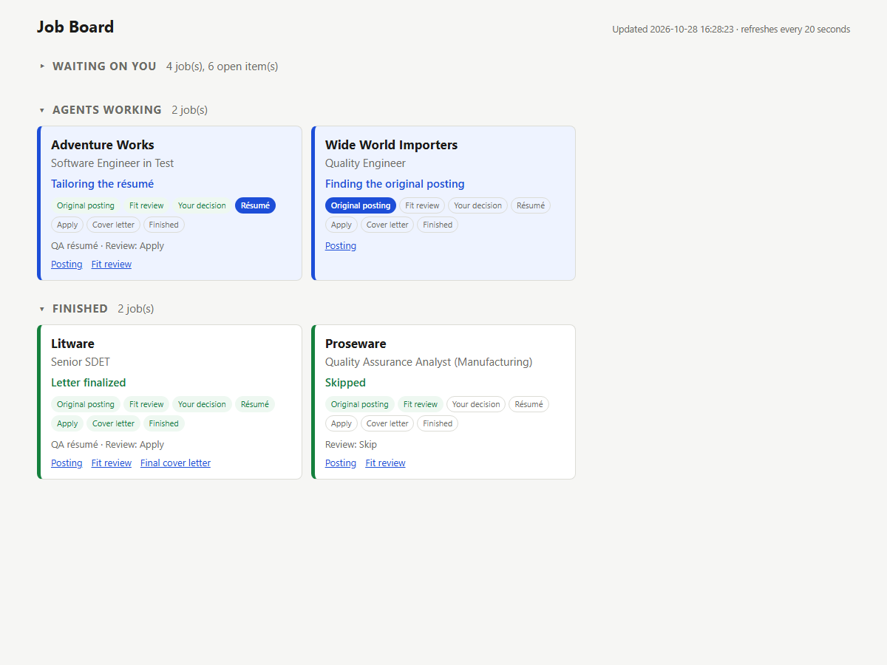

# job-application-workflow

A Claude Code setup for running many job applications at once without losing track of them.

You talk to one manager agent. You give it job-posting links. For each job it hands every step
(finding the employer's own posting, reviewing fit, tailoring your résumé, drafting a cover
letter) to a subagent that runs a skill, records where the job stands in a `state.json` file,
and shows everything on an HTML job board that refreshes itself. It stops and asks you at every
decision point, and it never applies, sends or submits anything.



## Why

Applying to a lot of jobs by hand means juggling postings, résumé versions, half-written
letters and questions you meant to answer. Running each job in a separate chat loses the
thread. This setup splits the work three ways:

- **A manager** that holds the state of every job, relays questions and never writes the
  documents itself, so its context stays small enough to manage many jobs.
- **Subagents** that each do one stage for one job, in parallel, following a skill with fixed
  rules.
- **A board** generated from the state files, so you can see at a glance what is waiting on you,
  what agents are working on, and what is finished.

## The pipeline



| # | Stage | Subagent | Skill | What it produces |
|---|---|---|---|---|
| 0 | Find the original posting | `source-finder` | `find-original-posting` | `source.md`: Confirmed, Likely or Not found, with the employer's URL |
| 1 | Fit review | `fit-reviewer` | `job-fit-review` | `fit-review.md`: verdict, gaps, location, pay, a suggested ask |
| 2 | Tailor the résumé | `resume-tailorer` | `tailor` | Questions, then a before and after change summary, then the tailored résumé text |
| 3 | Apply | you | | |
| 4 | Cover letter draft | `cover-letter-writer` | `cover-letter` | `cover-letter/draft.md` with a rating out of 10 and what it lacks |
| 5 | Finalize | `cover-letter-finalizer` | `cover-letter-final` | `cover-letter/final.md` after final checks |

## The gates

A gate is a point where the manager stops and waits for your explicit answer in chat. A
subagent's verdict, a default or silence never counts as a decision.

1. **Apply or skip**, after the fit review. Your decision wins over the review's verdict.
2. **Résumé questions and changes.** The tailoring agent first asks, in one batch, about every
   requirement your facts do not cover. Then it shows the proposed edits as before and after
   pairs, each with the fact it rests on. Nothing is produced until you approve.
3. **Cover letter or not.** You tell the manager you applied and whether the application takes
   a letter. The manager does not offer or start letters on its own.
4. **Letter feedback or approval.** Revisions loop until you say the letter is done.

The hard rules behind every stage:

- Never advance past a gate without your explicit word.
- Never claim anything you could not defend in an interview, even if the posting asks for it.
- Ask rather than assume about your experience. An unknown is a question, never a yes.
- Never edit your master résumé, and never contact anyone or submit anything.

## Parallel jobs and question hand-back

Give the manager several links in one message and it starts one subagent per job, in the
background, in a single step. Jobs then move at their own pace and sit at different stages.

Subagents cannot talk to you. When a skill reaches a point where it needs you (an unknown
requirement, a change summary to approve), the subagent stops and returns its questions as its
final message. The manager:

1. writes the questions into that job's `state.json`, which puts them on the board under
   "Waiting on you";
2. tells you, labeled by company and number, for example "Contoso Labs 2";
3. when you answer ("Contoso 2: no, never used it"), marks the question answered and resumes
   the **same** subagent with your answers, so it keeps everything it already read.

When several jobs report at once, the manager gives one line per job and goes through the long
ones one at a time.

## The state file

Each job has a folder `jobs/<slug>/` holding `state.json` and every file produced for it. The
manager updates `state.json` whenever a stage starts, a subagent reports or you decide, so it
can pick up after a session closes.

```json
{
  "slug": "contoso-labs-sdet",
  "company": "Contoso Labs",
  "role": "Software Development Engineer in Test",
  "url": "https://jobs.example.com/contoso/sdet-2291",
  "original_url": null,
  "stage": "awaiting-tailor-input",
  "verdict": "Apply",
  "user_decision": "Apply",
  "track": null,
  "agent_ids": {"source": null, "fit": "...", "tailor": "...", "cover": null},
  "files": {
    "source": null,
    "fit_review": "jobs/contoso-labs-sdet/fit-review.md",
    "resume_changes": "jobs/contoso-labs-sdet/resume-changes.md",
    "resume_folder": null,
    "resume_file": null,
    "cover_draft": null,
    "cover_final": null
  },
  "questions": [
    {"id": "1", "text": "The posting asks for Pact. Have you used it, and where?", "status": "open"}
  ],
  "pending_for_user": "The posting asks for Pact. Have you used it, and where?",
  "notes": ""
}
```

| Field | Meaning |
|---|---|
| `stage` | Where the job is. See the list below. |
| `verdict` | The fit review's recommendation. |
| `user_decision` | Your apply or skip decision at gate 1. |
| `track` | Optional. Which master résumé to use when you keep more than one. |
| `agent_ids` | The subagent for each stage, so the manager can resume it. |
| `files` | Paths to what each stage produced. The board links them. |
| `questions` | Everything waiting on you, numbered per job. `status` is `open` or `answered`. |
| `pending_for_user` | A one-line summary of what is waiting on you. |
| `kind` | Optional. Set to `task` for work that is not an application. |

Stages, grouped the way the board groups them:

| Board section | Stages |
|---|---|
| Waiting on you | `awaiting-gate-1`, `awaiting-tailor-input`, `awaiting-resume-approval`, `applying`, `awaiting-gate-3`, `awaiting-cover-feedback`, `awaiting-finalize-ok`, `task-you` |
| Agents working | `intake`, `finding-original`, `fit-review`, `tailoring`, `cover-drafting`, `finalizing`, `task-agents` |
| Finished | `skipped`, `no-cover-letter`, `finalized`, `done`, `task-done` |

## The board

```
python scripts/board.py            one text line per job, with open questions
python scripts/board.py --html     write board.html at the project root
python scripts/board.py --watch    regenerate board.html whenever a state.json changes
```

Open `board.html` in a browser and leave it open; it reloads every 20 seconds. The manager
starts `--watch` in the background at the start of a session. Each card shows the company, role,
current stage, a step tracker, open questions and links to the posting and the files produced.
Sections collapse, and the board remembers which ones you collapsed.



To see it with fictional data:

```
python scripts/demo.py
```

That creates eight fictional jobs in `jobs/demo-*/`, one or more in every section, and writes
`board.html`. `python scripts/demo.py --clean` removes them again. The demo only ever touches
`jobs/demo-*` folders. It needs Python 3 and a browser, nothing else.

## Setup

1. **Install [Claude Code](https://docs.anthropic.com/en/docs/claude-code)** and clone this
   repository. Run Claude Code from the repository folder so it picks up `CLAUDE.md`, the
   agents in `.claude/agents/` and the skills in `.claude/skills/`.
2. **Write your facts.** Copy each example in `context/` and fill it in with your own details:
   - `context/profile.example.md` to `context/profile.md`: target roles, roles to skip,
     location rules, pay preferences, where your master résumé is, how you produce documents,
     and any standing rules of your own.
   - `context/career-facts.example.md` to `context/career-facts.md`: every claim you can
     defend, with where and for how long, plus your known gaps and the claims that are always
     wrong. This is the only source the agents may draw on, so the more concrete it is, the
     fewer questions you get.
   - `context/house-style.example.md` to `context/house-style.md`: your writing rules, the
     cover-letter structure you want and the rating scale.

   The examples describe a fictional candidate, Alex Example, to show the level of detail
   that works. Your own `context/*.md` files are listed in `.gitignore`.
3. **Adjust the skills if you need to.** The skills read `context/` by relative path. If you
   keep your facts elsewhere, change the "Read these first" section of each `SKILL.md`. Model
   and effort for each stage are set in the frontmatter of `.claude/agents/*.md`.
4. **Describe your document tooling.** The skills prepare the text of a tailored résumé and a
   final cover letter. Producing the actual document (a word-processor file, a PDF) is up to
   you: say in `profile.md` how you do it, with whatever tooling you prefer, and the agents
   follow that. If you describe none, they stop at the text and tell you the document still
   needs making.
5. **Start.** Open `board.html`, then give the manager a job link.
6. **Before you publish a fork,** copy `.leakcheck-terms.example.txt` to `.leakcheck-terms.txt`,
   list your personal strings in it (name, email, employers, salary figures, local paths) and
   run `python scripts/leakcheck.py`. It fails if any of them, or an em dash, appears in a file
   name or text file. Use `--publishable` to check only what git would commit.

## Repository layout

```
CLAUDE.md                        the manager's instructions
.claude/agents/                  one thin wrapper per stage: model, effort, and the skill it runs
.claude/skills/                  the rules for each stage
  find-original-posting/references/aggregators.md
context/*.example.md             example facts for a fictional candidate
scripts/board.py                 the board generator
scripts/demo.py                  fictional demo jobs
scripts/leakcheck.py             fails on personal strings before you publish
docs/                            screenshots
jobs/                            your jobs (ignored by git)
board.html                       the generated board (ignored by git)
```

## Limitations

- **It does not apply for you.** You fill in every application form yourself. The agents never
  submit, email, message or sign up for anything.
- **It does not build documents.** The skills produce text and change lists. Making the
  `.docx` or PDF is left to your own tooling.
- **It needs Claude Code.** The manager, subagents, background tasks and `SendMessage`
  resumption are Claude Code features. The board and demo scripts run on plain Python 3, but
  the workflow does not run without Claude Code.
- **The output is only as good as your facts file.** If `career-facts.md` is thin, you get many
  questions; if it is wrong, the résumé is wrong.
- **Fit reviews and pay suggestions are estimates** from the posting and your profile, not
  market data you can rely on. Check them.
- **Posting pages change and some block automated reading.** When a page cannot be read, the
  agents say so and ask for the text.
- **The board is a local file.** It reloads every 20 seconds and is not a web app; there is no
  server, login or sync across machines.

## License

MIT. See [LICENSE](LICENSE).
